# abu — Android Backup Utility

Back up your Android phone's internal storage (`/sdcard`) over **adb**, and **restore** it again later. abu has a terminal UI. It checks every file it copies and can pick up where it stopped after a pause, a pulled cable or a crash.

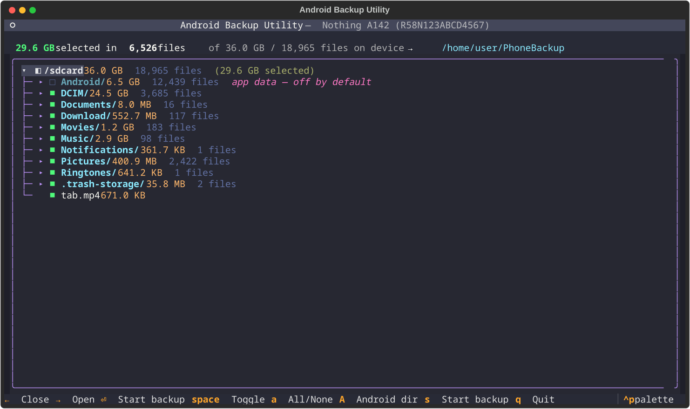

- **Pick folders in a tree.** Every folder shows its size and file count. Tick or untick whole folders or single files, and use `→` / `←` to open and close folders.
- **`Android/` is left out by default.** It holds app data and caches. You can tick it if you want it.
- **Live progress.** Overall and per-file progress bars, with speed, time remaining and counts.
- **Pause and resume** with one key. Pausing never throws away a large file that is halfway copied.
- **Every file is checked.** abu compares sizes after each copy, and MD5 checksums too if you ask for them. A half-copied file never ends up under its real name.
- **Survives disconnects.** If the phone drops off, abu waits for it to come back and retries the file.
- **Resumes after a crash.** Progress is saved per file. Run abu again into the same folder and it carries on.
- **Updates an old backup.** Running it again into an earlier backup folder only copies new or changed files.
- **Restore with `abu restore`.** Push a backup back onto the phone or onto a new phone. Files already there are skipped, and files that differ are kept unless you choose to overwrite them.
- **Quick with small files.** Small files from the same folder are copied in batches, so folders with thousands of thumbnails are not slowed down by per-file overhead.

---

## Contents

- [Requirements](#requirements)
- [Installation](#installation)
- [Quick start](#quick-start)
- [The folder picker](#the-folder-picker)
- [The backup screen](#the-backup-screen)
- [Interruptions, resuming and updating a backup](#interruptions-resuming-and-updating-a-backup)
- [Restoring a backup](#restoring-a-backup)
- [Command-line reference](#command-line-reference)
- [Where things are saved](#where-things-are-saved)
- [Troubleshooting](#troubleshooting)
- [How it works (technical)](docs/HOW-IT-WORKS.md)

---

## Requirements

| What | Notes |
| --- | --- |
| Python 3.10+ | |
| [`adb`](https://developer.android.com/tools/releases/platform-tools) | Part of Android platform-tools. It must be on your `PATH`. |
| An Android phone with **USB debugging** turned on | Go to *Settings → About phone*, tap *Build number* 7 times, then turn on *Developer options → USB debugging*. |

When you first plug the phone in, accept the **"Allow USB debugging?"** prompt on the phone. `adb devices` should then list it as `device`, not `unauthorized`.

## Installation

With [uv](https://docs.astral.sh/uv/) (recommended):

```bash
git clone <this repo> android_backup_utility
cd android_backup_utility
uv run abu                       # creates the venv, installs deps, runs the app
```

To make `abu` available from any folder:

```bash
uv tool install -e .
abu ~/PhoneBackup
```

With plain pip:

```bash
python3 -m venv .venv
.venv/bin/pip install -e .
.venv/bin/abu
```

## Quick start

```bash
abu ~/PhoneBackup
```

1. abu finds the phone. If more than one device is connected, it asks which one to use.
2. It scans `/sdcard`, which takes a few seconds for ~20k files.
3. You choose folders in the picker and press **Enter**.
4. Wait for the backup to finish. Press **`p`** to pause and **`q`** to stop. Run the same command again to resume.

## The folder picker

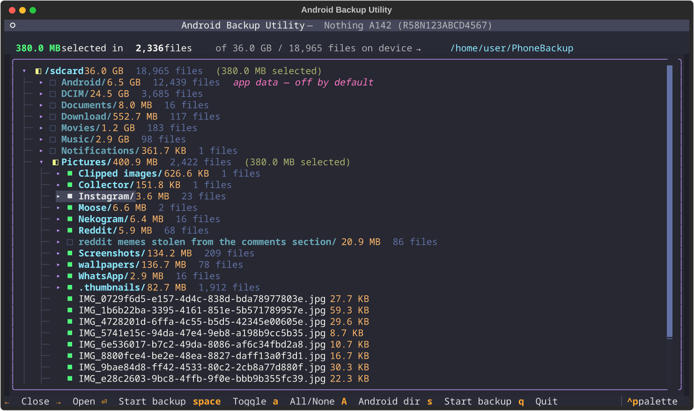

The top line shows how much is selected, the total on the device, and where the backup will go.

Each row shows:

| Mark | Meaning |
| --- | --- |
| `■` (green) | Everything in this folder is selected |
| `◧` (yellow) | Part of the folder is selected. The row also shows how much, e.g. "(380.0 MB selected)" |
| `□` (grey) | Nothing in this folder is selected |
| `▸` / `▾` | Folder is closed / open |

Keys:

| Key | Action |
| --- | --- |
| `↑` `↓` (or `k` `j`) | Move up and down |
| `→` (or `l`) | Open the folder. If it's already open, jump to its first item |
| `←` (or `h`) | Close the folder. If it's already closed, jump to its parent |
| `space` | Tick or untick the folder or file under the cursor, including everything inside it |
| `a` | Select everything, or nothing |
| `A` | Tick or untick the `Android/` folder |
| `enter` / `s` | Start the backup |
| `q` | Quit |

Folders come before files, and hidden items come after visible ones.
Folders are only built when you open them, so the tree stays fast on phones with hundreds of thousands of files.

> **About `Android/`:** this folder holds app data (`Android/data`, `Android/obb`, `Android/media`). It is often large, much of it is cache, and on Android 11 and later adb can only read part of it. That's why it is left out by default. Use `A` or `--include-android` to back it up anyway.

## The backup screen

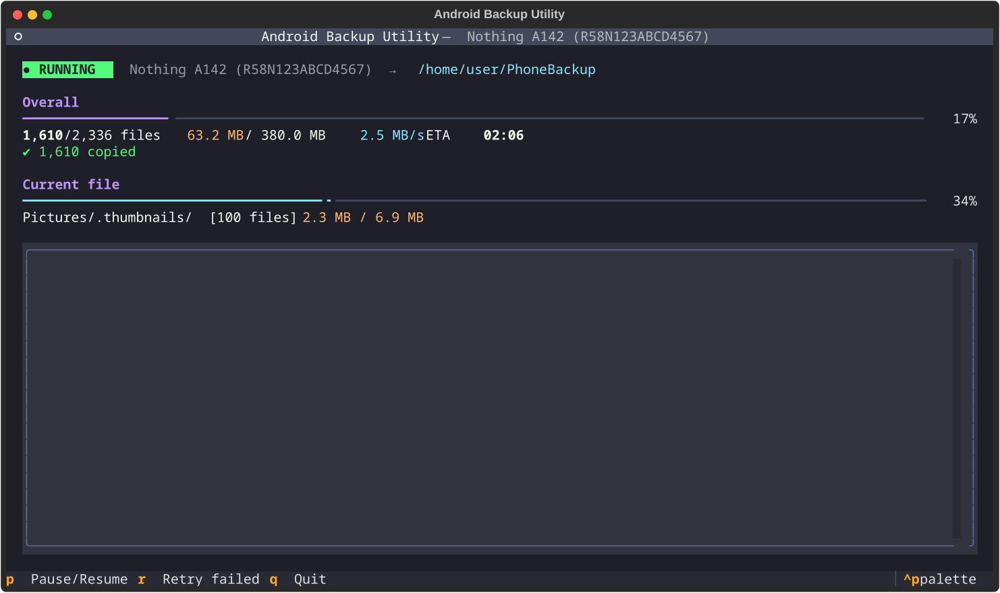

- **Status badge:** `RUNNING`, `VERIFYING`, `PAUSED`, `WAITING FOR DEVICE`, `COMPLETE` or `STOPPED`.
- **Overall bar:** files done out of the total, bytes, current speed and estimated time left.
  It also counts files *copied*, files *already present* from an earlier run, and files that *failed*.
- **Current file bar:** progress of the file being copied. When small files are copied as a batch,
  this shows the folder and the number of files, e.g. `Pictures/.thumbnails/ [100 files]`.
- **Log:** reconnects, retries, failures and the final summary.

| Key | Action |
| --- | --- |
| `p` / `space` | Pause or resume |
| `r` | Retry failed files (once the run has finished) |
| `q` / `Ctrl+C` | Stop and quit, after asking you to confirm. Your progress is saved |

### Pausing

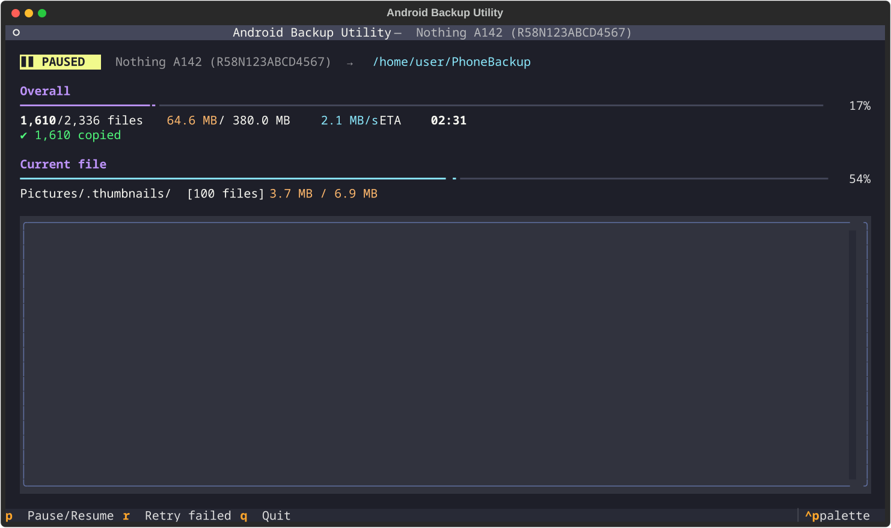

Pausing **freezes** the running `adb pull` instead of killing it. When you resume, the copy carries on from the same byte, so pausing during a 4 GB video doesn't start that file over.
(On Windows, which can't freeze a process, the current file is restarted instead.)

### When the phone disconnects

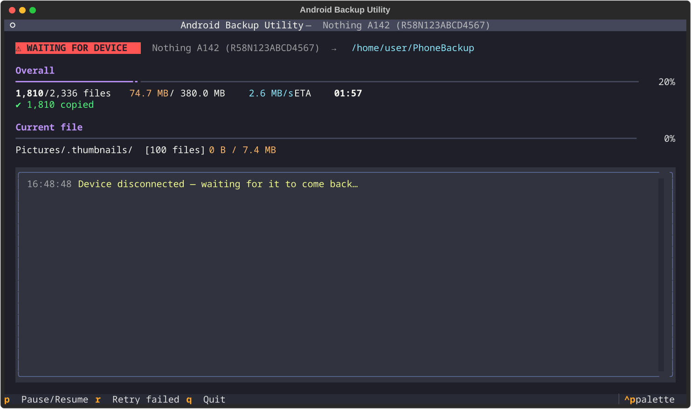

If a copy fails and the phone is no longer connected, abu:

1. Throws away the partial file.
2. Shows **WAITING FOR DEVICE** and checks once a second.
3. Retries the same file once the phone is back.

A disconnect **does not count** against the file's retry limit. Only real errors do, such as a permission problem or a size mismatch.

### Finishing

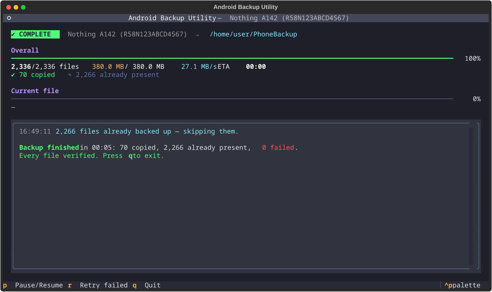

When the run ends you get a summary. If any files failed, they are listed in `<output>/.abu/failed.txt` with the error, and **`r`** retries them.

## Interruptions, resuming and updating a backup

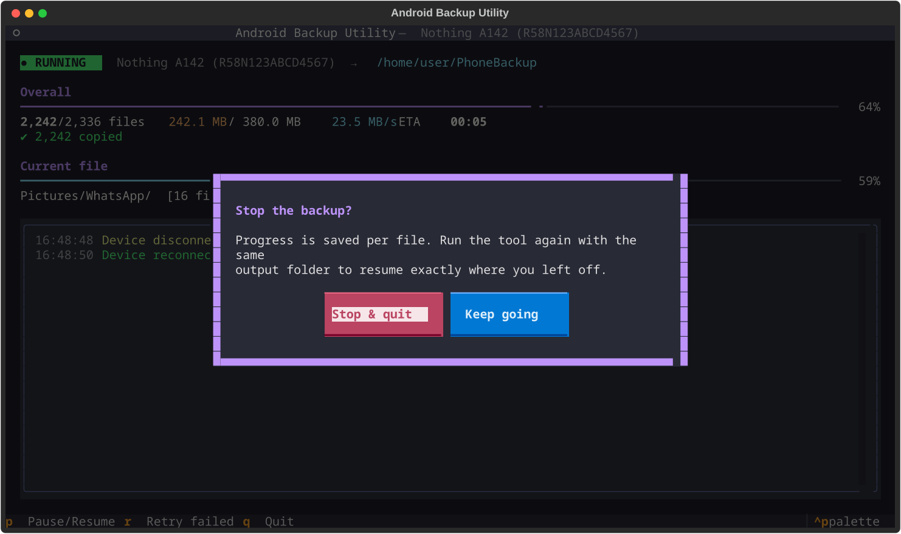

You can stop at any time: press `q`, press Ctrl+C, close the terminal, pull the cable, or let the laptop go to sleep.
Run abu again with the **same output folder** and it asks:

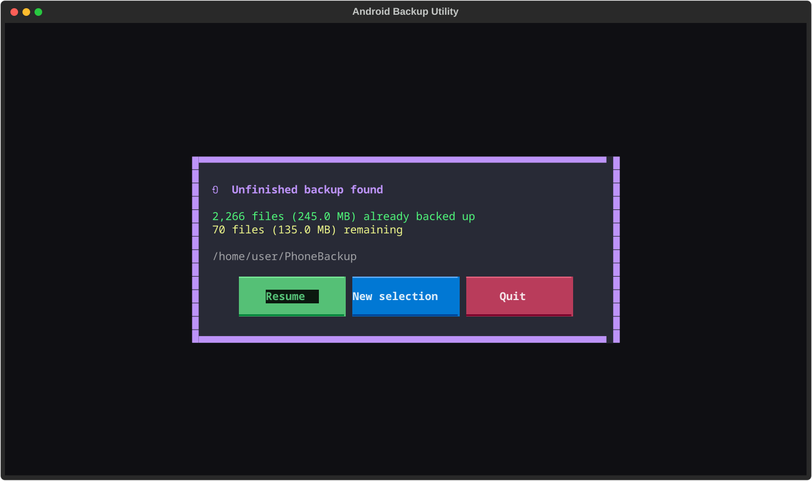

- **Resume:** carry on with the remaining files from the saved list, without scanning again. Failed files are tried again too.
- **New selection:** scan the phone again and open the picker with your previous selection already ticked.
  Files already backed up whose size and modified time haven't changed are **skipped**.
- `--resume` / `--new` answer this question for you, for scripts and cron jobs.

Running abu again later into an old backup folder works the same way. Only new or changed files are copied.

> abu never deletes files from your backup, even if you deleted them on the phone. It only adds and updates.

## Restoring a backup

```bash
abu restore ~/PhoneBackup                 # push it back into /sdcard on the connected phone
abu restore ~/PhoneBackup --to /sdcard/Restored/   # or into another folder
abu restore ~/PhoneBackup --overwrite     # replace phone files that differ from the backup
```

abu reads the backup folder and scans the phone. It then opens the same folder picker, with each row marked to show how it compares with the phone:

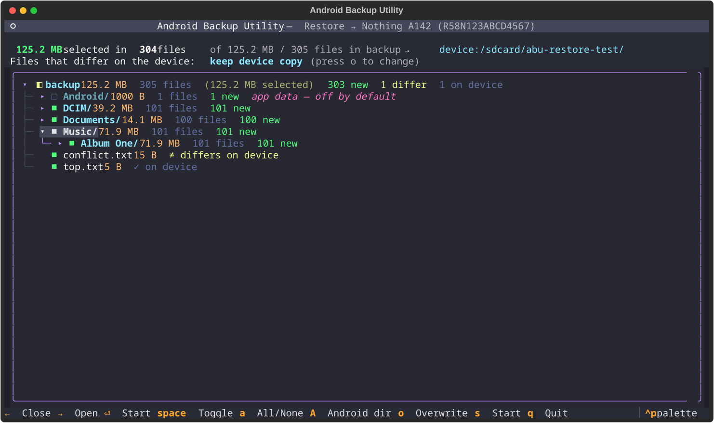

| Label | Meaning |
| --- | --- |
| `new` (green) | Not on the phone yet. It will be pushed |
| `✓ on device` (grey) | Already on the phone with the same size. Skipped |
| `≠ differs on device` (yellow) | A file with the same path but a different size is on the phone. **Kept as it is** unless overwrite is on |
| `N new · N differ · N on device` | The same counts, totalled for each folder |

Press **`o`** in the picker, or pass `--overwrite`, to switch between *keep the phone's copy* (the default) and *overwrite*.
Before anything is written, abu shows exactly what it will do:

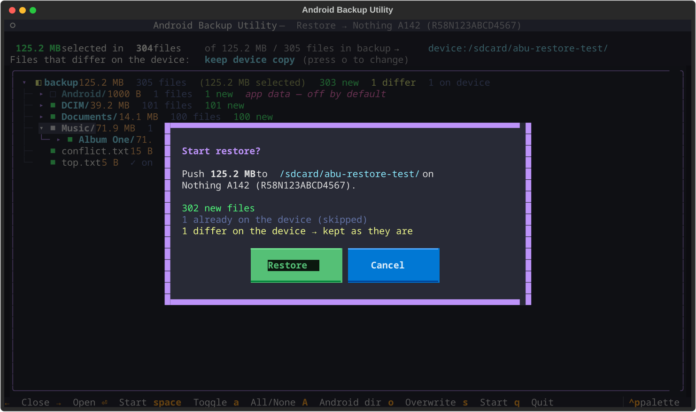

The restore runs on the same screen as a backup, with the same pause, reconnect, quit and resume behaviour:

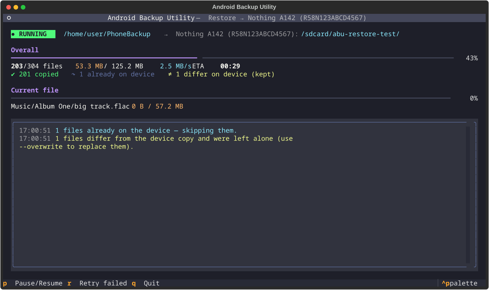

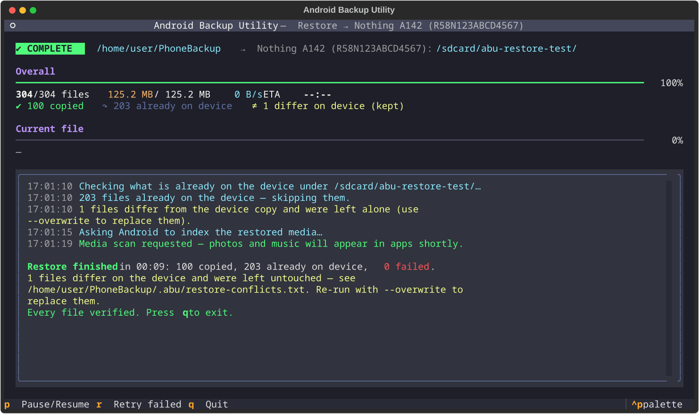

How the restore keeps your phone safe:

- **Nothing half-written is left on the phone.** Each file is first pushed into a hidden staging folder on the phone, `<target>/.abu-staging/`, which contains a `.nomedia` file. Its size is checked there, plus MD5 with `--verify-hash`, and only then is it moved into place. A broken transfer never leaves a truncated photo in your gallery or replaces a good file with a damaged one.
- **Original modified times are kept**, so the gallery keeps photos in date order.
- **Nothing is deleted from the phone.** Files that differ are left alone unless you opt in to overwriting.
- **The gallery updates afterwards.** When the restore finishes, abu asks Android to rescan storage so restored photos, videos and music show up in apps.
- **Resumable.** Progress is saved in `<backup>/.abu/restore.db`. Run `abu restore` again on the same folder to resume. The target folder is remembered, so you don't need to pass `--to` again.
- Files that differ are listed in `.abu/restore-conflicts.txt`, and failed files in `.abu/restore-failed.txt`.

> **`Android/` and restore:** on Android 11 and later, adb can't write into other apps' `Android/data` folders, so that folder is unticked by default here too.

## Command-line reference

```
abu [backup] [OUTPUT_DIR] [options]        # back up (default command)
abu restore BACKUP_DIR [--to DIR] [--overwrite] [options]
```

Options for both commands:

| Option | Description |
| --- | --- |
| `OUTPUT_DIR` | *(backup)* Where to save the backup. Default: `./backups/<model>_<serial>/`. Use the same folder to resume or update a backup. |
| `-s, --serial SERIAL` | Which device to use when several are connected. Without it, abu asks. |
| `--verify-hash` | Also compare MD5 checksums from the phone and the computer for every file. This is the strongest check, and noticeably slower on large files. |
| `--retries N` | Attempts per file before it is marked failed (default `3`). Disconnects don't count. |
| `--include-android` | Tick `Android/` in the picker from the start. |
| `--resume` | If there is an unfinished backup, resume it without asking. |
| `--new` | Ignore unfinished work and go straight to scanning and the picker. |
| `-V, --version` | Print the version. |

Restore only:

| Option | Description |
| --- | --- |
| `BACKUP_DIR` | A folder created by `abu backup`. Any folder laid out like `/sdcard` works. |
| `--to DIR` | Folder on the phone to restore into. Default: `/sdcard/`, or the folder used last time when resuming. |
| `--overwrite` | Replace phone files whose size differs from the backup. Without it, those files are kept as they are and reported as conflicts. |

## Where things are saved

```
~/PhoneBackup/
├── DCIM/Camera/IMG_0001.jpg      ← same layout as /sdcard on the phone
├── Pictures/…
├── Download/…
└── .abu/
    ├── state.db                  ← per-file progress (SQLite)
    ├── failed.txt                ← files that failed to back up, with the error (if any)
    ├── restore.db                ← restore progress (only after `abu restore`)
    ├── restore-failed.txt        ← files that failed to restore
    ├── restore-conflicts.txt     ← files that differ on the phone and were left alone
    └── staging/                  ← temporary folder for batch copies (removed after each batch)
```

- Copied files keep the **modified time they have on the phone**.
- While a file is being copied it is called `name.abu-part`. It only gets its real name after it has been checked.

## Troubleshooting

| Problem | Fix |
| --- | --- |
| "No device connected" | Run `adb devices`. If it says `unauthorized`, unlock the phone and accept the prompt. If nothing is listed, try another cable or port and make sure USB debugging is on. |
| "`adb` was not found in PATH" | Install platform-tools (on Arch: `pacman -S android-tools`; on Debian/Ubuntu: `apt install adb`) or add the SDK's `platform-tools` folder to your `PATH`. |
| Some files under `Android/data` are missing | On Android 11 and later, adb can't read other apps' private folders. This is an Android restriction, not something abu can work around. |
| Some files fail with "file no longer exists on device" | The file was deleted between the scan and the copy, which happens with caches and thumbnails. This is harmless. |
| Copies are slow | Use a USB 3 cable and port. A phone that is locked with the screen off sometimes slows USB down. Leave `--verify-hash` off unless you need it. |
| Restored photos don't show up in the gallery | abu asks Android to rescan at the end. If that is blocked on your phone, reboot it, or open the gallery app and wait a minute for it to index. |
| Restore reports many files that differ on the phone | Those files were changed on the phone after the backup. Look at `.abu/restore-conflicts.txt`, then re-run with `--overwrite` if you want the backup versions. |
| You want to start completely from scratch | Delete `<output>/.abu/`, or choose a new output folder. |

---

To understand or change the code, see [docs/HOW-IT-WORKS.md](docs/HOW-IT-WORKS.md).
